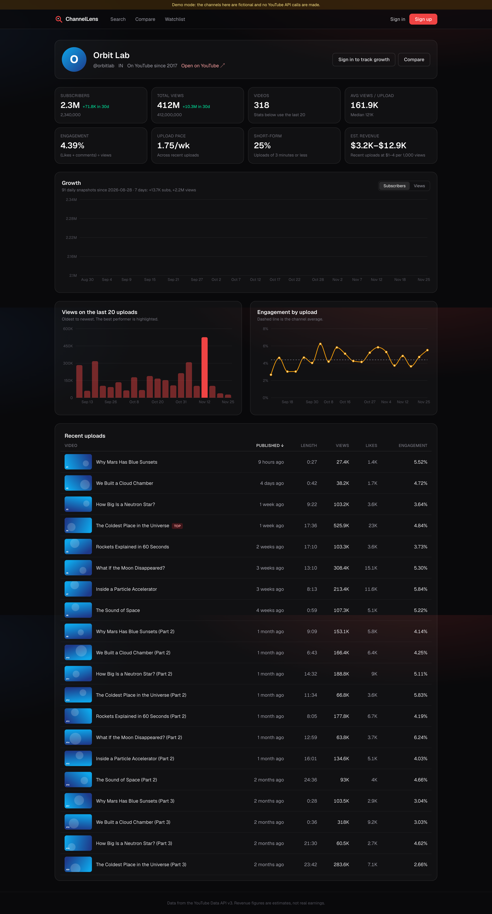
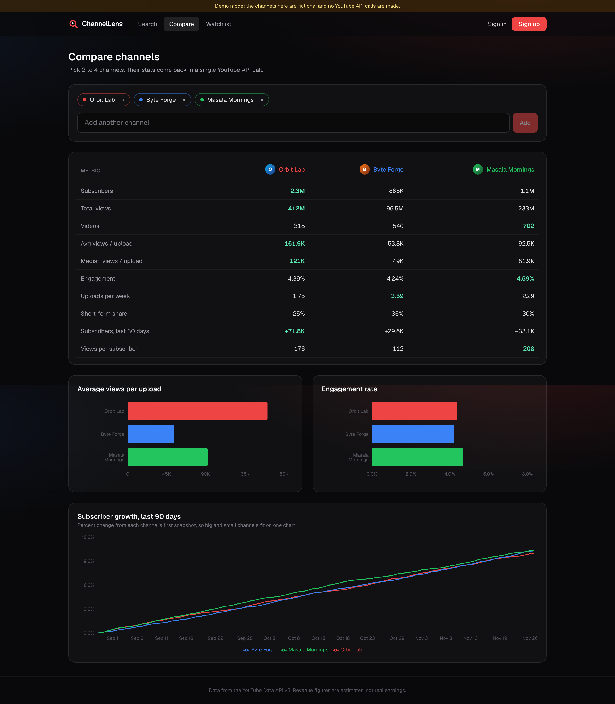
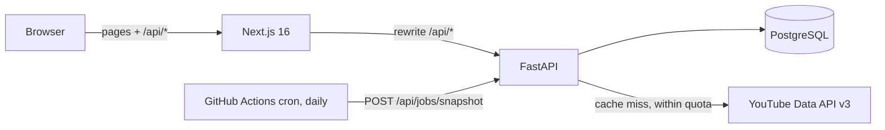

# ChannelLens

[](https://github.com/sheershh/ChannelLens/actions/workflows/ci.yml)

Full-stack YouTube channel analytics. Look up any channel, compare up to four side by side,
keep a watchlist, and track subscriber and view growth over time from daily snapshots.



**Stack:** Next.js 16 (App Router, TypeScript, Tailwind, Recharts) · FastAPI · SQLAlchemy 2 ·
PostgreSQL · Docker · GitHub Actions · pytest · Vitest · Playwright

## Features

- **Search** by channel name, `@handle`, channel ID or a pasted YouTube link.
- **Dashboard:** subscribers, views, upload pace, engagement rate, short-form share, an estimated
  revenue range, charts of the last 20 uploads, and a sortable video table.
- **Compare** 2 to 4 channels. The leader on each metric is highlighted, and subscriber growth is
  plotted as percent change so a 50K channel and a 5M channel share one chart.
- **Accounts and watchlists.** A daily job snapshots every watched channel, which builds the
  growth history that the YouTube API itself doesn't provide.
- **Demo mode** (`DEMO_MODE=true`) serves three fictional channels with 90 days of history, so the
  whole app runs with no API key and no network.



## Engineering notes

### Spending 3 quota units instead of 202

The YouTube Data API gives each project 10,000 units a day. A `search` call costs 100, while
`channels`, `playlistItems` and `videos` cost 1 each. The first version of this project (a Streamlit
script) called `search` twice per lookup.

| Operation | Prototype | ChannelLens |
|---|---|---|
| Full channel report | ~202 units | **3 units** (channel → uploads playlist → video stats) |
| `@handle`, channel ID or URL lookup | 100 | **1** (`channels?forHandle=`) |
| Repeat visit within the cache window | ~202 | **0** |
| Daily refresh of N watched channels | n/a | **⌈N / 50⌉** (batched `channels` calls) |

Other choices in the same direction:
- Every upstream response is cached in the database (1 hour by default, 24 hours for name searches).
- Usage is metered per **Pacific-time day**, matching Google's reset. A call that would exceed the
  budget is refused with HTTP 429 before it is sent.
- The search box only queries on submit, never on each keystroke.

### Other decisions

- **Same-origin API.** Next.js rewrites `/api/*` to FastAPI, so the session cookie is first-party,
  `httpOnly` and `SameSite=Lax`, with no CORS setup in production.
- **Auth:** bcrypt hashes, JWT in a cookie or `Bearer` header, and a `?next=` redirect guard
  against open redirects.
- **SQLite behaves like Postgres in tests.** Foreign keys are enforced on SQLite, and CI runs the
  backend suite against both databases.
- **Honest numbers.** Revenue is shown as a range ($1 to $4 per 1,000 views, configurable). Hidden
  subscriber and like counts show as "Hidden" and are excluded from the engagement ratio instead of
  being counted as zero.

## Architecture



## Tests

| Suite | Tool | Count |
|---|---|---|
| Backend: API, quota and cache accounting, auth, jobs | pytest, on SQLite and PostgreSQL | 57 |
| Frontend: formatting, API client, components | Vitest + Testing Library | 49 |
| End to end: search → dashboard → sign up → watchlist → compare | Playwright (desktop + mobile) | 9 |

The backend tests run against a fake YouTube API plugged in through `httpx.MockTransport`. Each
test asserts the exact upstream calls an endpoint makes, which is how the quota numbers above are
checked.

## Run it locally

Demo mode needs no API key:

```bash
# API
cd backend
python3.12 -m venv .venv && .venv/bin/pip install -r requirements-dev.txt
DEMO_MODE=true .venv/bin/uvicorn app.main:app --reload       # http://localhost:8000/docs

# Web (second terminal)
cd frontend
npm install && npm run dev                                    # http://localhost:3000
```

To use real YouTube data, copy `backend/.env.example` to `backend/.env` and add a YouTube Data API
v3 key: in Google Cloud Console, enable the API, then go to Credentials → Create API key.

With Postgres: `docker compose up --build` starts Postgres and the API. Then run the frontend as above.

```bash
cd backend && .venv/bin/pytest          # backend tests
cd frontend && npm test                 # unit tests
cd frontend && npm run test:e2e         # starts both servers in demo mode, runs Playwright
```

## Deploy

- **API and database:** Render Blueprint (`render.yaml`) creates the Docker web service and a Postgres
  database. It asks for `YOUTUBE_API_KEY` and `CORS_ORIGINS` and generates the secrets.
- **Frontend:** Vercel, with root directory `frontend` and env var `BACKEND_URL` set to the Render URL.
- **Daily snapshots:** add repository secrets `CHANNELLENS_API_URL` and `CHANNELLENS_CRON_SECRET`.
  `.github/workflows/daily-snapshot.yml` then runs at 06:00 IST.

## Project layout

```
backend/   FastAPI app (app/), pytest suite (tests/), Dockerfile
frontend/  Next.js app (src/app, src/components, src/lib), Vitest + Playwright tests
docs/      screenshots
```
